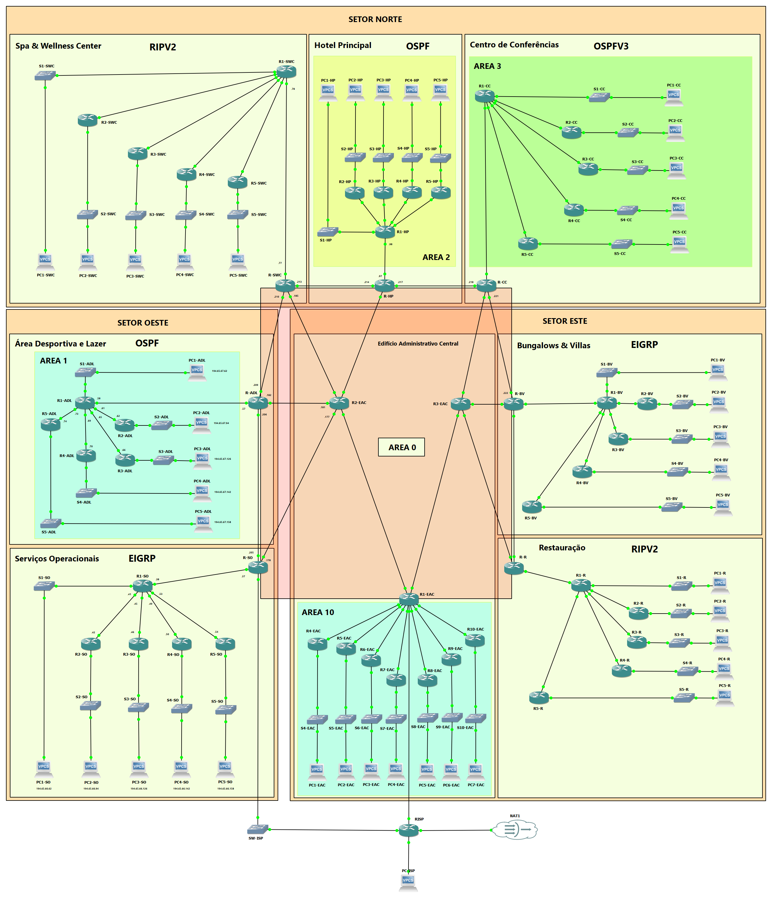

# Data Forwarding Project

Practical project developed within the scope of the Data Forwarding course of the Bachelor's Degree in Computer Engineering (Networking and Systems Administration Track) at ISEC.

## Network Overview

The project consisted of designing and configuring a network infrastructure for a large-scale resort. The architecture followed a Hub-and-Spoke model, using the Edifício Administrativo Central (EAC) as the core responsible for aggregating traffic, summarizing routes, and applying core policies.

The network was divided into three main sectors:
- **Setor Oeste:** Área Desportiva e Lazer (ADL) running OSPF, and Serviços Operacionais (SO) running EIGRP.
- **Setor Este:** Edifício Administrativo Central (EAC) with OSPF, Bungalows & Villas (BV) with EIGRP, and the Restaurant with RIPv2.
- **Setor Norte:** Centro de Conferências (CC) with OSPFv3, Hotel Principal (HP) with OSPF, and the Spa & Wellness Center (SWC) with RIPv2.

## What Was Implemented

- **Dynamic Routing:** Configuration of multiple protocols simultaneously (OSPF, OSPFv3, EIGRP, and RIPv2) depending on the network zone.
- **Internet Gateway:** NAT implementation for address translation, featuring a primary 1 Gbps link at the EAC and a *backup* link (100 Mbps) at the Serviços Operacionais.
- **Traffic Policies (PBR):** Creation of *Policy-Based Routes* and *Access Lists* in the Spa & Wellness Center to enforce specific paths for traffic.
- **Filters:** Use of *Prefix-lists* in Serviços Operacionais to control and limit the routes that were advertised.
- **Remote Access:** Telnet configuration on routers with single-session restriction and custom welcome messages per device.

## ⚠️ Notes and Areas for Improvement

- **External Connectivity:** The configuration of the internet *backup* path in Serviços Operacionais presented limitations in return traffic forwarding, identified as an area for optimization in future resilience testing.

## Repository Contents

- [`topology/`](topology/) - Image containing the logical network topology and respective simulation files.
- [`excel/`](excel/) - Detailed IP addressing table (with complete subnet planning).
